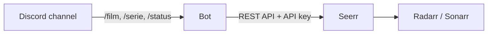

# seerr-discord-bot

Request movies and shows from Discord. The bot searches [Seerr](https://docs.seerr.dev), shows the
poster and whether a title is already there, and requests it with one click. Seerr then hands it
to Radarr or Sonarr as usual.

```text
/film Sintel
  Sintel (2010) · ➕ Noch nicht da, kann angefragt werden      [📥 Anfragen] [Abbrechen]
  ✅ Angefragt! Der Film wird jetzt gesucht und geladen. Sobald alles da ist, taucht es in Jellyfin auf.

/status
  Sintel (2010) · ⬇️ wird geladen, 45 % · von alex
```

> The bot's messages are in German.

## Features

- **`/film <titel>` and `/serie <titel>`**: up to five hits to pick from, with poster, year, short
  description and status (already there, partly there, requested, downloading).
- **Seasons.** For shows, the missing seasons are preselected; you can narrow them down. Specials are left out.
- **`/status`**: requests waiting for approval, what is being searched or downloaded (with progress) and free space.
- **Watches the disk.** Below `MIN_FREE_GB` free, new requests are refused with a clear message, and the
  bot posts once in the channel when space gets low and once when it is fine again.
- **`/löschen <titel>`** (admins only): pick a movie or show from the library and delete it, files
  included, after a second confirmation click. It is reset in Seerr, so it can be requested again later.
- **Only where it belongs.** The bot answers in one channel; optionally only members with a role may request.
- **Approval stays in Seerr.** Requests can be made for a Seerr user without auto-approve, so they
  wait for an admin, or as the admin, so they start at once.
- **Your search, your buttons.** Only the person who searched can pick and request.

## How it works



The bot only talks to Discord and to Seerr's API. It stores nothing.

## Setup

### 1. Create the Discord bot

1. [Discord Developer Portal](https://discord.com/developers/applications) → **New Application** → **Bot** → **Reset Token**, copy it.
2. **OAuth2 → URL Generator**: scopes `bot` and `applications.commands`; bot permissions
   **View Channels**, **Send Messages**, **Embed Links**. Open the link and add the bot to your server.
   No privileged intents are needed.
3. Discord → User Settings → Advanced → **Developer Mode** on. Right-click → **Copy ID** for the server,
   the channel and (optionally) the role that may request.

### 2. Seerr API key

Seerr → **Settings → General → API Key**. The key has admin rights, keep it private.

Optional: create a Seerr user for Discord requests (Settings → Users) **without** "Auto-Approve" and put
its ID into `SEERR_USER_ID`. Requests then wait for your approval in Seerr.

### 3. Run it

```bash
git clone https://github.com/jonesthala/seerr-discord-bot.git seerrbot && cd seerrbot
cp .env.example .env && chmod 600 .env    # fill in the values
docker compose up -d --build
```

Without Docker Compose:

```bash
docker build -t seerrbot .
docker run -d --name seerrbot --restart unless-stopped --env-file .env seerrbot
```

Check that it started: `docker logs seerrbot` should end with `Logged in as <your bot>`. Then try
`/film Sintel` in your channel.

To update: `git pull`, then the same build and run again (remove the old container first with
`docker rm -f seerrbot` when not using Compose).

Without Docker (Python 3.11 or newer):

```bash
python -m venv .venv && . .venv/bin/activate
pip install -r requirements.txt
set -a && . ./.env && set +a
python -m bot
```

## Settings

| Variable | Default | Meaning |
| --- | --- | --- |
| `DISCORD_TOKEN` | – | Bot token |
| `DISCORD_GUILD_ID`, `DISCORD_CHANNEL_ID` | – | Server and channel the bot works in |
| `DISCORD_REQUEST_ROLE_ID` | empty | Only this role may search and request; empty = everyone in the channel |
| `DISCORD_ADMIN_ROLE_ID`, `DISCORD_ADMIN_USER_IDS` | empty | Who may use `/löschen`; both empty = deleting is off |
| `MIN_FREE_GB` | `15` | Refuse new requests and warn below this much free space |
| `SEERR_URL` | `http://localhost:5055` | How the bot reaches Seerr |
| `SEERR_API_KEY` | – | Seerr API key |
| `SEERR_LANGUAGE` | `de` | Language of titles and descriptions |
| `SEERR_USER_ID` | empty | Request for this Seerr user instead of the key's owner |
| `SEERR_PUBLIC_URL` | empty | Link to Seerr in the bot's messages |

## Security

- The Seerr API key can do everything an admin can. Keep `.env` private (`chmod 600`) and out of Git.
- Requests made as the admin are approved at once. If others can use the bot, set `SEERR_USER_ID` or a
  request role.
- The container runs as an unprivileged user and needs no ports.
- `/löschen` removes files for good. Only the admins you list can use it, and it always asks twice.

## Deleting and hardlinks

Radarr and Sonarr usually import downloads as **hardlinks**: the file in the library and the one your
torrent client is still seeding share the same disk space. Deleting from the library alone frees
**nothing** while the torrent is still there. Give your torrent client a seeding limit (ratio or time)
that removes finished torrents, or remove them by hand, so `/löschen` really frees space.

## Troubleshooting

| Problem | What to do |
| --- | --- |
| `Improper token has been passed`, or the log says `DISCORD_TOKEN is the app's Public Key` | You copied the Public Key or the Client Secret. The token is only on the app's **Bot** page: **Reset Token**. |
| `Environment variable … is missing` or `… must be a number` | A value in `.env` is empty or has a typo. IDs are numbers only (Developer Mode → Copy ID). |
| The slash commands don't show up | The bot registers them for `DISCORD_GUILD_ID` when it starts. Check the server ID and that the invite link had the `applications.commands` scope, then reload Discord (Ctrl+R). |
| „Bitte im #kanal benutzen.“ | The bot only answers in `DISCORD_CHANNEL_ID`. |
| „Seerr lehnt den API-Key ab“ | Wrong `SEERR_API_KEY`, or it was regenerated in Seerr. |
| Requests are refused because of space | Less than `MIN_FREE_GB` is free in Radarr's or Sonarr's root folder. Free some space (see [Deleting and hardlinks](#deleting-and-hardlinks)) or lower the value. |
| `/löschen` says deleting is off | Set `DISCORD_ADMIN_USER_IDS` or `DISCORD_ADMIN_ROLE_ID`. |

Logs: `docker logs --tail 50 seerrbot`.

## Development

```bash
python -m unittest discover -s tests -v
```

The tests cover everything except the Discord layer: parsing Seerr's answers, seasons, status texts,
requests and errors, with a fake Seerr and no network. They need no extra packages.

## License

[MIT](LICENSE)
